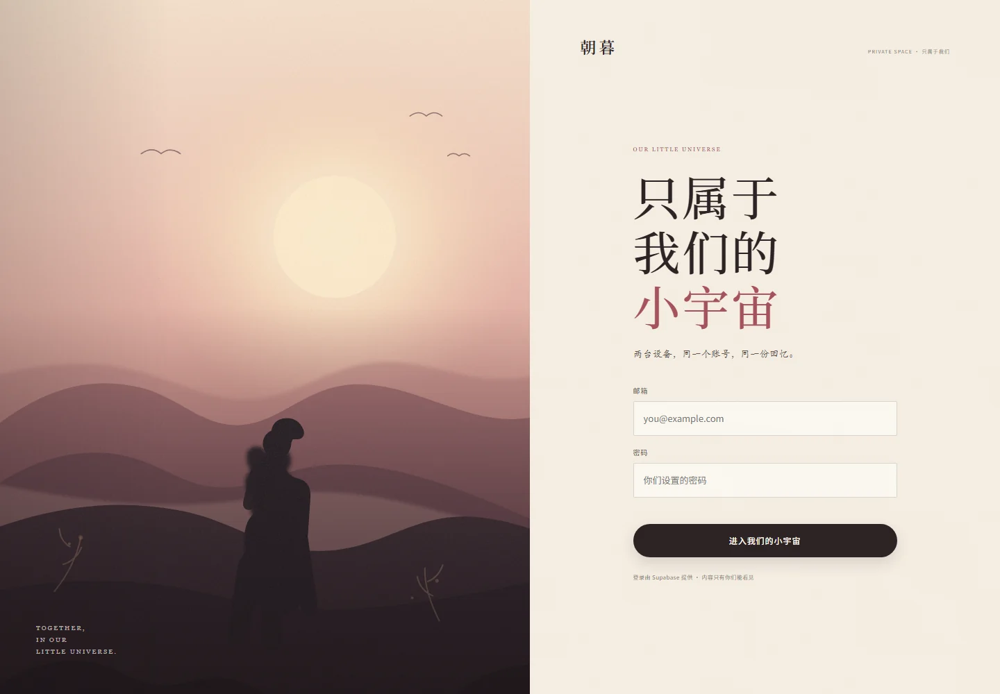
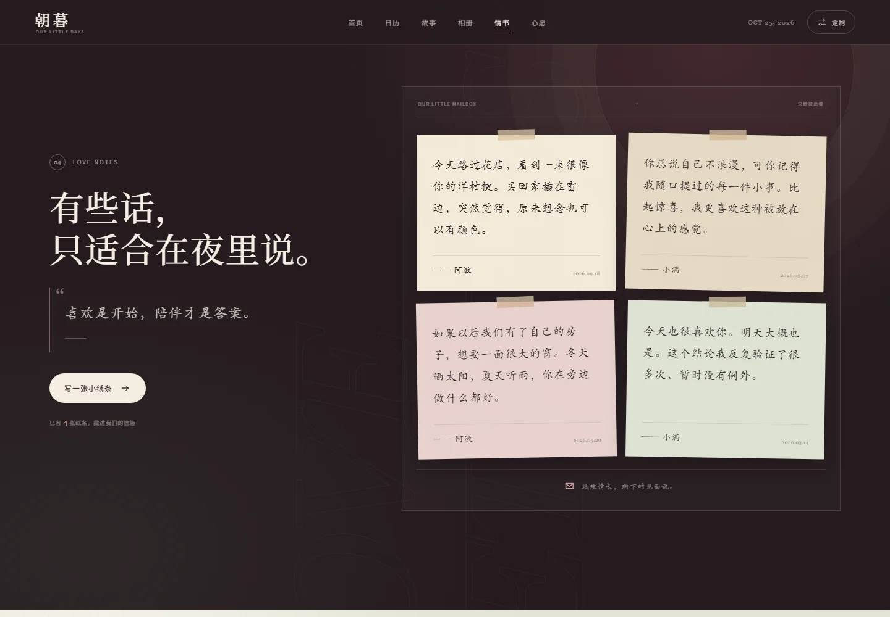
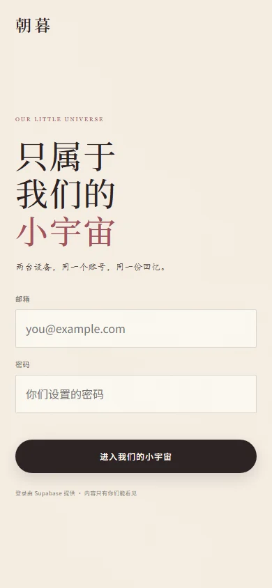
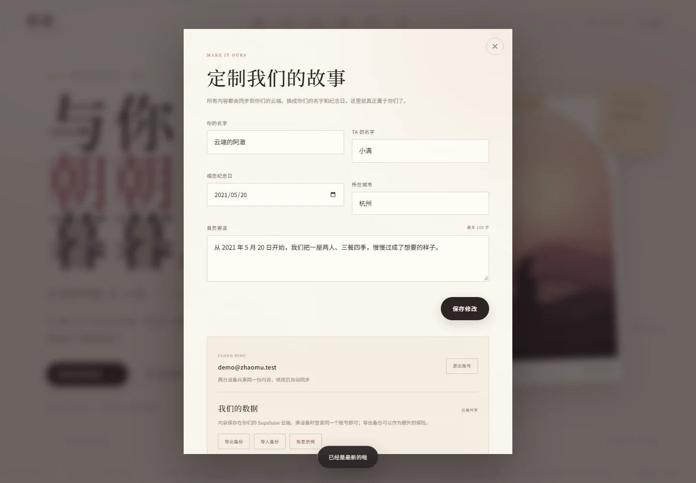

# 朝暮 · OUR LITTLE DAYS

一个温暖的情侣纪念网站。  
记录相恋天数、回忆相册、深夜小纸条，以及还没一起完成的心愿。

支持两种模式：

- **单机模式**：双击 `index.html` 直接使用，所有内容保存在当前浏览器，不需要账号。
- **云端共享模式**：登录同一个账号，两台设备看到同一份内容；网站放 GitHub Pages，数据放 Supabase。电脑关机后也能在手机/另一台电脑打开。

> 当前交付默认是单机模式。  
> 想改成两台设备共享，请按 **[SUPABASE_SETUP.md](SUPABASE_SETUP.md)** 走一遍，大约 15 分钟。


## 先看效果

云端模式的登录页：






## 已包含

- 相恋天数实时计算（含今天）
- 下一个纪念日倒计时、百天里程碑
- 照片数量、纸条数量、心愿完成度统计
- 自动生成的「我们的故事」时间轴
- 相册分类筛选、上传、压缩、灯箱、左右切换、删除
- 深夜情书留言与删除
- 心愿清单勾选、新增、删除、进度环
- 桌面 / 平板 / 手机响应式布局
- 花瓣、爱心、滚动揭示、深色章节、键盘操作
- 单机模式下本地持久化、JSON 备份导出/导入
- 云端模式下 Supabase 登录、白名单权限、自动同步、手动同步、退出账号

## 两种使用方式

### 方式 A：单机版（最简单）

双击 `打开网站.bat` 或 `index.html`，推荐 Chrome / Edge。

- 不需要安装、不需要联网
- 数据保存在当前浏览器
- 换电脑、换浏览器或清理浏览器数据会丢失，请用「定制 → 我们的数据 → 导出备份」
- 只能在当前这台电脑上打开

### 方式 B：云端共享版（手机 + 电脑同步）

按 **[SUPABASE_SETUP.md](SUPABASE_SETUP.md)** 配置后：

1. 网站页面部署在 GitHub Pages，得到一个固定网址
2. 你们的内容存在自己的 Supabase 数据库
3. 两台设备登录同一个账号，看到同一份照片、纸条、心愿
4. 另一台设备修改后，20 秒内 / 切回页面时 / 点右上角「已同步」时更新
5. 电脑关机后，用手机打开网址仍然可以用

云端配置完成后，登录页长这样：



云端模式的设置面板：



## 怎么把它变成你们的

打开页面后，点右上角 **定制**：

- 改成你们的名字
- 设置相恋纪念日（天数会自动重新计算）
- 修改所在城市和首页寄语
- 单机模式导出 / 导入备份
- 云端模式查看同步账号、退出登录

其他内容：

- **回忆相册**：点「放进一张照片」上传，可一次选多张；点照片查看大图，左右切换，也可以删除
- **深夜情书**：写小纸条、选落款，纸条会出现在信箱里
- **心愿清单**：勾选完成、添加新心愿；顶部进度环会自动更新

## 文件结构

```text
.
├─ index.html                    # 页面结构
├─ 打开网站.bat                  # 双击打开单机版
├─ assets/
│  ├─ css/style.css              # 全部样式
│  ├─ js/config.js               # 云端地址和 Publishable key 填这里
│  ├─ js/cloud.js                # Supabase 登录和数据同步
│  ├─ js/app.js                  # 页面交互与数据
│  └─ img/                       # 示例插画、图标
├─ supabase/
│  └─ schema.sql                 # 云端数据表 + 权限策略
├─ SUPABASE_SETUP.md             # 云端共享版配置教程
├─ preview/                      # 预览图（可删除，不影响网站）
└─ README.md
```

## 数据与隐私

### 单机模式

- 使用浏览器 `localStorage`
- 照片上传前会压缩到最长边 1600px
- 清理浏览器缓存 / 网站数据会删除内容
- 建议定期导出 JSON 备份

### 云端模式

- 页面在 GitHub Pages，内容在**你自己的 Supabase 项目**
- 只有 `couple_owner` 白名单里的账号能读写
- 网页里使用的是 **Publishable key**（或旧版 `anon` key）；**不能**把 Secret / `service_role` key 放进前端
- 数据库密码和 Secret / `service_role` key 不要发给别人
- 单次同步约限制 4.6MB，照片会压缩到最长边 1400px
  - 正常相册建议保留 20～30 张精修照片
  - 想要几百张原图，需要再接入 Supabase Storage

## 部署到网上

详细步骤见 **[SUPABASE_SETUP.md](SUPABASE_SETUP.md)**。核心是：

- **网站**：GitHub 仓库 → Settings → Pages → Deploy from a branch → `main` / root
- **数据**：Supabase 项目 → SQL Editor 执行 `supabase/schema.sql` → 创建登录用户 → 填入 `assets/js/config.js`
- **访问**：`https://你的用户名.github.io/仓库名/`

免费 GitHub Pages 需要 public 仓库。代码和示例图会公开，但真实数据在 Supabase 里，受登录和白名单保护。

## 想让示例更像你们

不需要改代码：

1. 在「定制」里填写你们的名字、纪念日、城市和首页寄语。
2. 在相册里逐张删除示例插画。
3. 上传你们的照片，写下日期和一句话。
4. 删掉示例纸条和心愿，换成你们自己的。

如果之前已经在单机模式里填了内容，想迁移到云端：

1. 单机模式里「定制 → 我们的数据 → 导出备份」
2. 配置好云端并登录
3. 同一位置「导入备份」
4. 云端会保存这份内容，另一台设备登录后即可看到

## 小提示

- 按 `Esc` 关闭弹窗 / 照片预览
- 照片预览里可以用 `←` `→` 切换
- 写纸条时按 `Ctrl + Enter`（Mac 是 `Cmd + Enter`）快速提交
- 右上角「已同步」可以点击，立即从另一台设备拉取更新

---

Made with love, and a little bit of code.
